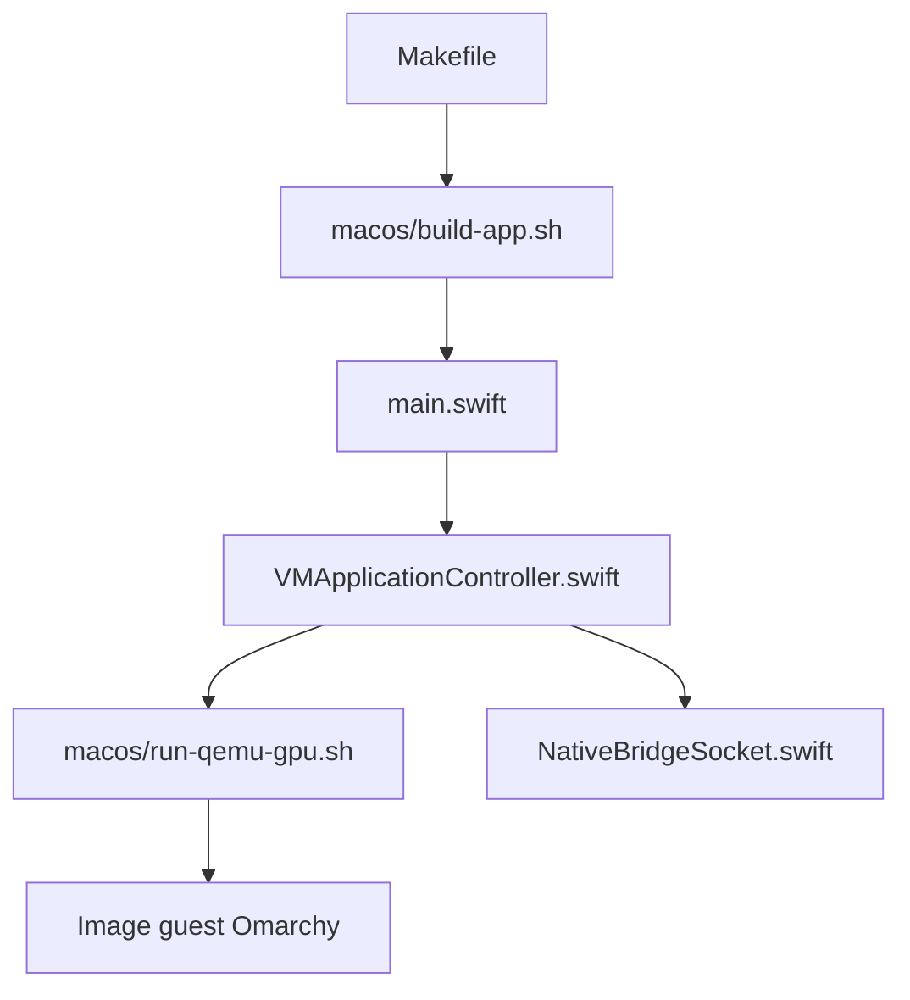

# omacom/try-omarchy

> Mac app that runs the Omarchy Linux desktop in a virtual machine integrated into macOS.

## The problem
Trying Omarchy on an Apple Silicon Mac requires setting up a VM and wiring up clipboard, audio and camera yourself.

## What it actually does
The app provides the official aarch64 Omarchy image in a QEMU VM accelerated by the Apple hypervisor, with virtio GPU. It connects the clipboard, microphone, camera, battery, a shared folder, Touch ID for `sudo`, bridged networking and USB (experimental). Omarchy updates itself; the app updates the integrations.

## How it is wired

## Trying it
No command line: download the `.dmg` from Releases, drag it into Applications, then click Launch Omarchy.

## Cost and gotchas
Free. Apple Silicon Mac, macOS 15+, about 15 GB free; first launch with a download of about 3 GB. Limits: video decoding on CPU, no Vulkan, edge channel only for ARM.

## What it is not
Not a data or compute tool; nor is it native Linux on Mac, but a VM.

## Alternatives
No alternative named in the README.

## For you
Ignore: a Linux workstation on Mac, unrelated to data / AI / MLOps needs.
