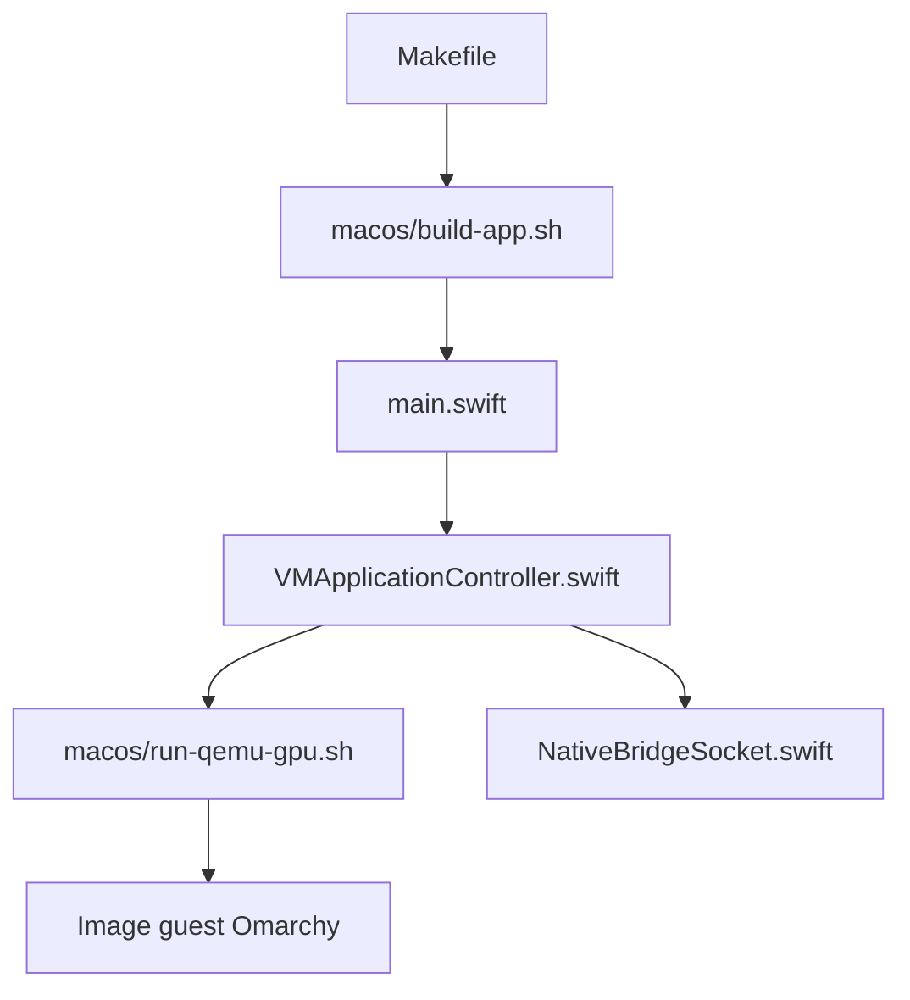

# omacom/try-omarchy

> Application Mac qui lance le bureau Linux Omarchy dans une machine virtuelle intégrée à macOS.

## Le problème
Essayer Omarchy sur un Mac Apple Silicon demande de monter une VM et de brancher soi-même presse-papiers, audio et caméra.

## Ce que ça fait vraiment
L'app fournit l'image officielle aarch64 d'Omarchy dans une VM QEMU accélérée par l'hyperviseur Apple, avec GPU virtio. Elle relie le presse-papiers, le micro, la caméra, la batterie, un dossier partagé, Touch ID pour `sudo`, le réseau ponté et l'USB (expérimental). Omarchy se met à jour lui-même ; l'app met à jour les intégrations.

## Comment c'est branché

## Essayer
Aucune commande en ligne : télécharger le `.dmg` depuis Releases, le glisser dans Applications puis cliquer sur Launch Omarchy.

## Coût et pièges
Gratuit. Mac Apple Silicon, macOS 15+, environ 15 Go libres ; premier lancement avec un téléchargement d'environ 3 Go. Limites : décodage vidéo sur CPU, pas de Vulkan, canal edge seulement pour ARM.

## Ce que ce n'est pas
Ce n'est pas un outil de données ni de calcul ; ce n'est pas non plus un Linux natif sur Mac, mais une VM.

## Alternatives
Aucune alternative nommée dans le README.

## Pour toi
À ignorer : poste de travail Linux sur Mac, sans lien avec les besoins data / IA / MLOps.

