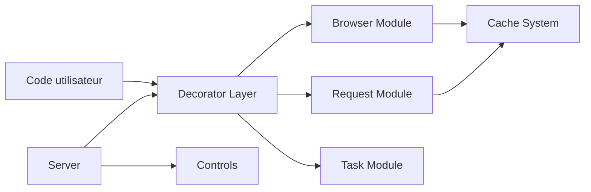

# omkarcloud/botasaurus

> Python web scraping framework with an automated browser, HTTP requests, caching, parallelism and a ready-to-use interface.

## The problem
Writing a reliable scraper means gluing together a browser, proxies, error retries, caching and export. The framework bundles these pieces behind three decorators.

## What it actually does
- `@browser`, `@request` and `@task` wrap a Python function and handle parallelism, caching, retries and JSON/Excel output.
- The in-house browser driver aims to look like human usage; the README claims it passes several anti-bot systems. These claims come from the author, with no independent measurement in the README.
- A server module generates a web interface and an API for a scraper. A "Desktop" option (JavaScript) turns it into a local application.
- Utilities: sitemap, link filtering, local storage, IP info, deployment on a VM or Kubernetes.

## How it is wired


## Trying it
```bash
python -m pip install --upgrade botasaurus
python main.py
git clone https://github.com/omkarcloud/botasaurus-starter my-botasaurus-project
python -m pip install -r requirements.txt
python run.py install
python run.py
```

## Cost and gotchas
The framework is free. Residential proxies, captcha solving (Capsolver, API key) and cloud VMs are at your expense. Node.js is required for proxy authentication.

## What it is not
It is not a permission to collect data: the README leaves compliance with the law (scraping, copyright, personal data) and with the terms of use of the targeted sites to the user. The protection-bypass capabilities are a legal and ethical point of vigilance. The author gives no guarantee of results.

## Alternatives
- Selenium and Playwright: the automation standards, with no "anti-detection" orientation.
- nodriver: inspired Botasaurus's driver.
- hrequests: inspired the requests module.

## For you
Worth watching: useful for building datasets from sources whose data you have the right to extract; check each site's terms of use first before industrializing.
