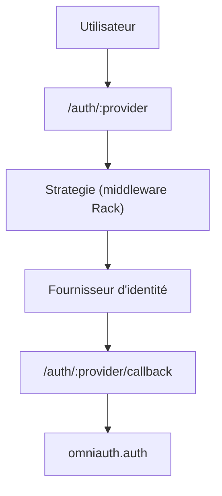

# omniauth/omniauth

> Ruby/Rack library that standardizes multi-provider authentication for web applications.

## The problem
Plugging in several identity providers (Twitter, LDAP...) requires as many different flows.

## What it actually does
Each strategy is a Rack middleware. The user is redirected to `/auth/:provider`, then OmniAuth fills an authentication hash in the Rack environment at `/auth/:provider/callback`. It protects the request phase against CSRF and supports full host, the origin parameter and SameSite cookies.

## How it is wired


## Trying it
```bash
# Gemfile
gem 'omniauth'
```

## Cost and gotchas
Free, but you need one strategy per provider (separate gems) and keys with each of them. Configure full_host or allowed_hosts, and validate omniauth.origin before any redirect.

## What it is not
Not user management: it creates no User model. The bundled Developer strategy is not safe for production.

## Alternatives
Devise, cited in the README for turnkey user management.

## For you
Ignore: a Ruby authentication building block, unrelated to a data/AI workflow.
