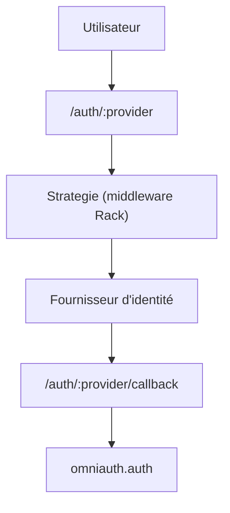

# omniauth/omniauth

> Bibliothèque Ruby/Rack qui normalise l'authentification multi-fournisseurs pour applications web.

## Le problème
Brancher plusieurs fournisseurs d'identité (Twitter, LDAP...) demande autant de flux différents.

## Ce que ça fait vraiment
Chaque stratégie est un middleware Rack. L'utilisateur est redirigé vers `/auth/:provider`, puis OmniAuth renseigne un hash d'authentification dans l'environnement Rack à `/auth/:provider/callback`. Il protège la phase de requête contre le CSRF et prend en charge hôte complet, paramètre origin et cookies SameSite.

## Comment c'est branché


## Essayer
```bash
# Gemfile
gem 'omniauth'
```

## Coût et pièges
Gratuit, mais il faut une stratégie par fournisseur (gems séparés) et des clés chez chacun. Configurer full_host ou allowed_hosts, et valider omniauth.origin avant toute redirection.

## Ce que ce n'est pas
Ce n'est pas une gestion d'utilisateurs : il ne crée aucun modèle User. La stratégie Developer incluse n'est pas sûre pour la production.

## Alternatives
Devise, cité dans le README pour une gestion d'utilisateurs clé en main.

## Pour toi
À ignorer : brique d'authentification Ruby, sans rapport avec un flux data/IA.

