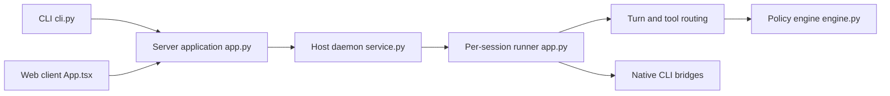

# omnigent-ai/omnigent

> Meta-harness that orchestrates Claude Code, Codex, Cursor and YAML agents, from terminal, web or mobile.

## The problem
Each coding agent has its own CLI, model and rules; combining them, governing them and sharing them across a team takes tinkering.

## What it actually does
Control-plane server (sessions, hosts, policies, credentials) and hosts launching per-session isolated runners.
Harnesses for Claude Code, Codex, Cursor, OpenCode, Hermes, Pi, Devin, Grok; custom YAML agents with Python tools, MCP and sub-agents.
Policies: approval before shell, call cap, dollar budget, at three levels (server, agent, session).
bwrap/seatbelt sandbox, cloud sandboxes (Modal, E2B, Daytona, Kubernetes…), web/desktop/mobile UI, session sharing and co-piloting.

## How it is wired


## Trying it
```bash
curl -fsSL https://raw.githubusercontent.com/omnigent-ai/omnigent/main/scripts/install_oss.sh | sh
omnigent
omnigent claude
omnigent run examples/polly/
omnigent start
```

## Cost and gotchas
Models at your expense (key, subscription or gateway). Requires uv, git, Node 22, tmux, bwrap on Linux. Anonymized telemetry enabled by default. Degraded mode on Windows.

## What it is not
Not an agent in itself: it drives the ones you already have. A three-month-old project with over 1,300 open issues: a moving surface.

## Alternatives
None named as competitors (integrates OpenClaw via ACP).

## For you
Worth watching: the budget policies and the cross-review between agents (Polly) address a real need, but the project is too young and too broad to adopt in a team now.
