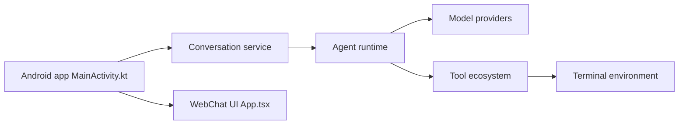

# omnimind-ai/OmniBot

> Android AI assistant that acts on the phone: tools, local workspace, calendar, contacts.

## The problem
A mobile chatbot stops at text: it plans nothing, has no access to files or phone context, and does not chain actions.

## What it actually does
Native Android app in Kotlin and Flutter: an understand, decide, execute loop. Tools (skills installable via repository link, Alpine, browser, MCP, system tools), scheduled tasks, memory with embeddings, authorized access to calendar, contacts, notifications, SMS and files. A Codex bridge drives Codex from a PC. A local WebUI exists.

## How it is wired


## Trying it
```bash
git clone https://github.com/omnimind-ai/OpenOmniBot.git
cd OpenOmniBot/ui && flutter pub get
cd .. && ./gradlew :app:installDevelopStandardDebug -Ptarget=lib/main_standard.dart
```

## Cost and gotchas
A configured model is needed (API key at your expense) and an embedding model. Tool results may be sent to your model. Builds call an omnimind backend (updates, anonymous statistics). Notifications are kept 7 days in local cache.

## What it is not
Not a local model: "on-device" refers to the app and its tools; inference goes through the configured provider. License not identified by GitHub.

## Alternatives
No alternative named in the README (it mentions the iOS/macOS version ViaVera).

## For you
Watch: a mobile agent demo, but very broad access to phone data, an unclear license and a third-party backend to clarify.
