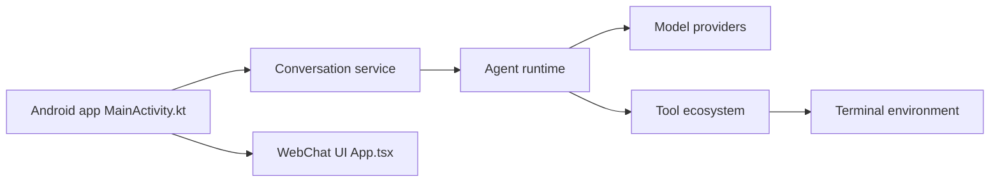

# omnimind-ai/OmniBot

> Assistant IA Android qui agit sur le téléphone : outils, espace de travail local, calendrier, contacts.

## Le problème
Un chatbot mobile s'arrête au texte : il ne planifie rien, n'accède ni aux fichiers ni au contexte du téléphone et n'enchaîne pas les actions.

## Ce que ça fait vraiment
App Android native Kotlin et Flutter : boucle comprendre, décider, exécuter. Outils (skills installables par lien de dépôt, Alpine, navigateur, MCP, outils système), tâches planifiées, mémoire avec embeddings, accès autorisé à calendrier, contacts, notifications, SMS et fichiers. Un bridge Codex pilote Codex depuis un PC. Une WebUI locale existe.

## Comment c'est branché


## Essayer
```bash
git clone https://github.com/omnimind-ai/OpenOmniBot.git
cd OpenOmniBot/ui && flutter pub get
cd .. && ./gradlew :app:installDevelopStandardDebug -Ptarget=lib/main_standard.dart
```

## Coût et pièges
Il faut un modèle configuré (clé d'API à ta charge) et un modèle d'embedding. Les résultats d'outils peuvent partir vers ton modèle. Les builds appellent un backend omnimind (mises à jour, statistiques anonymes). Notifications gardées 7 jours en cache local.

## Ce que ce n'est pas
Pas un modèle local : « on-device » désigne l'app et ses outils, l'inférence passe par le fournisseur configuré. Licence non identifiée par GitHub.

## Alternatives
Aucune alternative nommée dans le README (il cite la version iOS/macOS ViaVera).

## Pour toi
Surveiller : démonstration d'agent mobile, mais accès très large aux données du téléphone, licence floue et backend tiers à clarifier.

