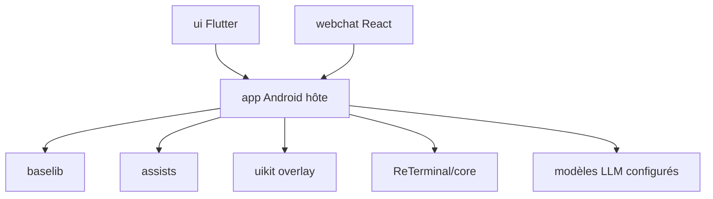

# omnimind-ai/OpenOmniBot

> Native Android AI agent that acts on the phone: tools, memory, scheduled tasks, personal context.

## The problem
A mobile chatbot only answers: it acts on neither the calendar, nor the files, nor the phone itself.

## What it actually does
Android app (Kotlin + Flutter) that loops understand, decide, execute, reflect. It exposes tools: skills, Alpine environment, browser, MCP, calendar, contacts, notifications, SMS. Short and long-term memory with embeddings. Scheduled tasks launch sub-agents. An optional bridge drives Codex on a PC.

## How it is wired


## Trying it
```bash
git clone https://github.com/omnimind-ai/OpenOmniBot.git
cd OpenOmniBot
cd ui
flutter pub get
cd ..
./gradlew :app:installDevelopStandardDebug -Ptarget=lib/main_standard.dart
```

## Cost and gotchas
You must configure an LLM (API key) and an embedding model for memory. The results of context queries may be sent to your model. A site backend handles updates, anonymous statistics and a VLM proxy.

## What it is not
Not an iOS version (it points to ViaVera). No ready-to-use binary documented: the README mostly describes the build. License present but not identified.

## Alternatives
No alternative named in the README.

## For you
Worth watching: the idea of a mobile agent with MCP is interesting for an AI profile, but the unclear license and the Flutter/Gradle build slow adoption.
