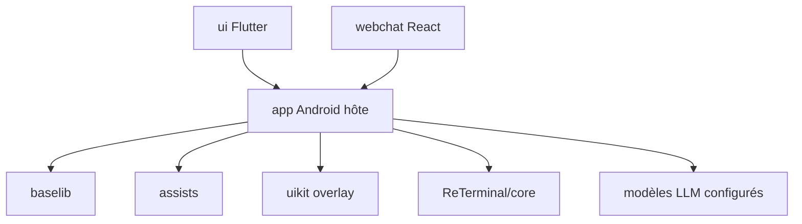

# omnimind-ai/OpenOmniBot

> Agent IA Android natif qui agit sur le téléphone : outils, mémoire, tâches planifiées, contexte personnel.

## Le problème
Un chatbot mobile ne fait que répondre : il n'agit ni sur le calendrier, ni sur les fichiers, ni sur le téléphone lui-même.

## Ce que ça fait vraiment
App Android (Kotlin + Flutter) qui boucle comprendre, décider, exécuter, réfléchir. Elle expose des outils : skills, environnement Alpine, navigateur, MCP, agenda, contacts, notifications, SMS. Mémoire courte et longue avec embeddings. Les tâches planifiées lancent des sous-agents. Un pont optionnel pilote Codex sur un PC.

## Comment c'est branché


## Essayer
```bash
git clone https://github.com/omnimind-ai/OpenOmniBot.git
cd OpenOmniBot
cd ui
flutter pub get
cd ..
./gradlew :app:installDevelopStandardDebug -Ptarget=lib/main_standard.dart
```

## Coût et pièges
Il faut configurer un modèle LLM (clé d'API) et un modèle d'embedding pour la mémoire. Les résultats des requêtes de contexte peuvent partir vers ton modèle. Un backend du site gère mises à jour, statistiques anonymes et proxy VLM.

## Ce que ce n'est pas
Pas une version iOS (renvoi vers ViaVera). Pas de binaire prêt à l'emploi documenté : le README décrit surtout la compilation. Licence présente mais non identifiée.

## Alternatives
Aucune alternative nommée dans le README.

## Pour toi
À surveiller : l'idée d'agent mobile avec MCP est intéressante pour un profil IA, mais la licence floue et la compilation Flutter/Gradle freinent l'adoption.

