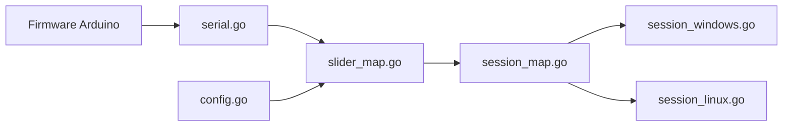

# omriharel/deej

> Open-source hardware volume mixer: Arduino sliders set the volume of applications.

## The problem
Changing the volume of a specific application, game, music or voice chat, forces you to leave what you are doing to open a software mixer.

## What it actually does
An Arduino reads slide potentiometers and sends their values over serial via USB. A lightweight Go client (about 10 MB of memory) reads the stream and adjusts the volume of audio sessions according to `config.yaml`, hot-reloaded: master, applications, microphone, system sounds, named devices. Works on Windows and Linux, with a system tray icon.

## How it is wired


## Trying it
```bash
go get -u github.com/omriharel/deej
# Arduino : flasher le sketch arduino\deej-5-sliders-vanilla
# PC : placer deej.exe et config.yaml dans le même dossier
```

## Cost and gotchas
Hardware to buy: Arduino board, linear potentiometers (not logarithmic), wires. No precompiled Linux binary: you have to build with libgtk-3-dev, libappindicator3-dev and libwebkit2gtk-4.0-dev. Last push in July 2024.

## What it is not
Not standalone software: without the Arduino part, it does nothing. The old Python version is no longer maintained (`legacy-python` branch).

## Alternatives
No alternative named in the README.

## For you
Ignore: a hardware tinkering project unrelated to your data/AI/MLOps work.
