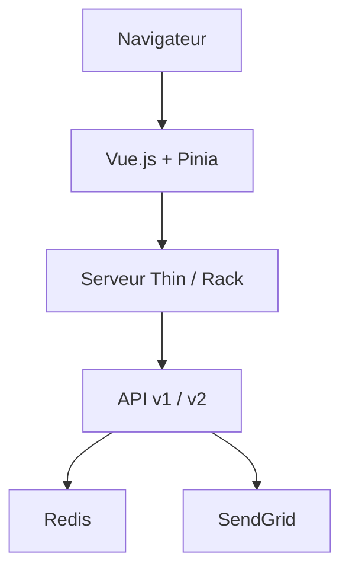

# onetimesecret/onetimesecret

> Web application for sharing secrets through single-use links, to keep passwords out of chats.

## The problem
A password sent by email or chat stays copied in many places.

## What it actually does
Generates a link that can be viewed only once; the secret is destroyed after reading. Ruby backend (API v1 and v2) with Redis for secrets, sessions and rate limiting; Vue frontend with Pinia; SendGrid/SMTP mail; Stripe for the paid plan, according to the diagram. Optional full authentication (PostgreSQL, RabbitMQ, MFA, WebAuthn). The README states AI-assisted development.

## How it is wired


## Trying it
```bash
docker run -p 6379:6379 -d redis:trixie
openssl rand -hex 32 > .ots_secret && chmod 600 .ots_secret
docker exec onetimesecret bin/ots customers create me@example.com --role colonel
```

## Cost and gotchas
Free; Redis to be provided. Losing the `SECRET` key makes existing secrets unreadable and unrecoverable: back it up.

## What it is not
Not a password vault: storage is deliberately ephemeral.

## Alternatives
- pglombardo/PasswordPusher: same principle, with audit log and files (in this batch).

## For you
Watch: handy for handing out credentials without leaving them in Slack, but peripheral for a data/AI profile.
