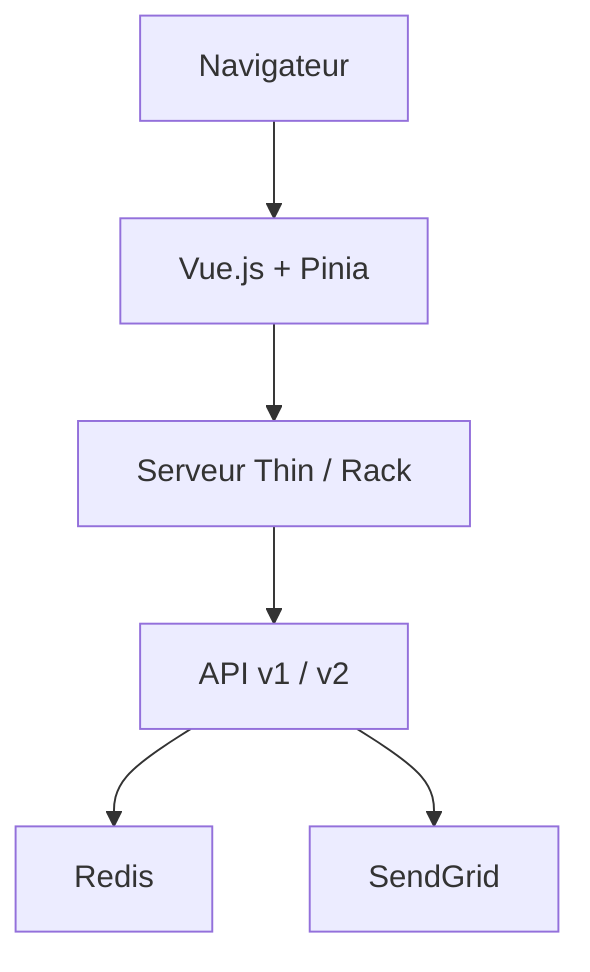

# onetimesecret/onetimesecret

> Application web de partage de secrets par liens à usage unique, pour garder mots de passe hors des chats.

## Le problème
Un mot de passe envoyé par email ou chat reste copié à de multiples endroits.

## Ce que ça fait vraiment
Génère un lien visible une seule fois ; le secret est détruit après lecture. Backend Ruby (API v1 et v2) avec Redis pour les secrets, sessions et limitation de débit ; frontend Vue avec Pinia ; courrier SendGrid/SMTP ; Stripe pour l'offre payante, d'après le diagramme. Authentification complète optionnelle (PostgreSQL, RabbitMQ, MFA, WebAuthn). Le README déclare un développement assisté par IA.

## Comment c'est branché


## Essayer
```bash
docker run -p 6379:6379 -d redis:trixie
openssl rand -hex 32 > .ots_secret && chmod 600 .ots_secret
docker exec onetimesecret bin/ots customers create me@example.com --role colonel
```

## Coût et pièges
Gratuit ; Redis à fournir. Perdre la clé `SECRET` rend les secrets existants illisibles et irrécupérables : sauvegarde-la.

## Ce que ce n'est pas
Pas un coffre de mots de passe : conservation volontairement éphémère.

## Alternatives
- pglombardo/PasswordPusher : même principe, avec journal d'audit et fichiers (dans ce lot).

## Pour toi
À surveiller : pratique pour distribuer des accès sans les laisser dans Slack, mais accessoire pour un profil data/IA.

