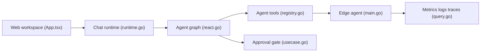

# ongridio/ongrid

> AI operations agent that investigates infrastructure incidents and answers from Slack or Telegram.

## The problem
Tracing an incident to its root cause means cross-referencing metrics, logs, traces and topology by hand, often in the middle of the night.

## What it actually does
A coordinator delegates to specialized agents (SRE, network, database), which query metrics, logs, traces, topology and a knowledge base. An Edge agent connects outbound, with no inbound port. Risky actions go through an approval gate. Model of your choice (Anthropic, OpenAI, GLM, DeepSeek, Gemini, Kimi).

## How it is wired


## Trying it
```bash
wget https://github.com/ongridio/ongrid/releases/download/v0.16.0/ongrid-v0.16.0-linux-amd64.tar.xz
tar -xf ongrid-v0.16.0-linux-amd64.tar.xz && cd ongrid-v0.16.0-linux-amd64
sudo ./install.sh
```

## Cost and gotchas
Model keys at your expense. Installation as root on Ubuntu 22.04+, Debian 12+ or RHEL/Rocky 9. Young project (created in May 2026), 74 open issues.

## What it is not
Not a simple chatbot: it deploys a full stack (Prometheus, Loki, Tempo, Grafana). AGPL-3.0: obligations if a modified version is offered as a network service.

## Alternatives
No alternative named in the README.

## For you
Worth watching: relevant if you operate infrastructure for AI services, but young and heavy to install; wait for stability before entrusting it with actions.
