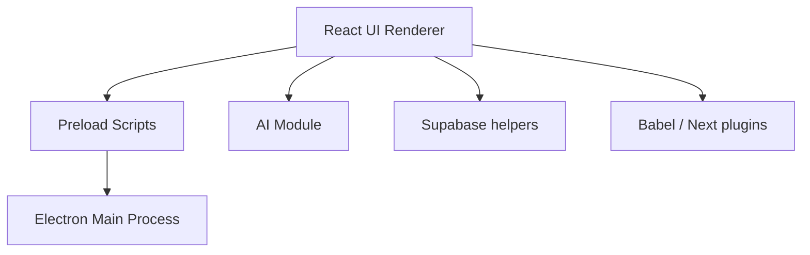

# onlook-dev/onlook

> Open source visual editor for Next.js and Tailwind, editing the DOM and the code in parallel with AI.

## The problem
Going from visual design to the code of a Next.js app without manual back-and-forth between Figma and the editor.

## What it actually does
The code runs in a web container, the editor shows the preview in an iframe and instruments the code to link each element to its line. A visual edit is carried over into the code; an AI chat has access to the code. Branches, checkpoints, deployment. The README mentions a hosted product in early access.

## How it is wired

## Trying it
No command documented in the provided README: use the hosted application or the documentation at docs.onlook.com.

## Cost and gotchas
Cited stack: Supabase, OpenRouter, CodeSandboxSDK, Freestyle. Local execution not detailed; third-party services and keys probably required.

## What it is not
Covers only Next.js and Tailwind for now. The README describes an original editor; the upcoming product is a different one.

## Alternatives
- Bolt.new, Lovable, V0, Replit Agent, Figma Make, Webflow: cited as alternatives that Onlook aims to replace.

## For you
Worth watching: useful for prototyping interfaces, outside the data/ML core.
