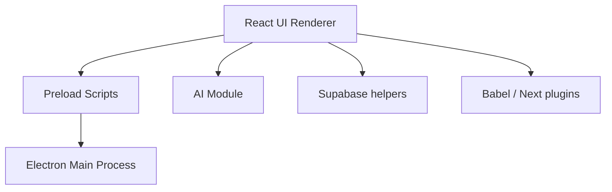

# onlook-dev/onlook

> Éditeur visuel open source pour Next.js et Tailwind, modifiant le DOM et le code en parallèle avec l'IA.

## Le problème
Passer du design visuel au code d'une appli Next.js sans aller-retour manuel entre Figma et l'éditeur.

## Ce que ça fait vraiment
Le code tourne dans un conteneur web, l'éditeur affiche l'aperçu dans une iframe et instrumente le code pour relier chaque élément à sa ligne. Une édition visuelle est reportée dans le code ; un chat IA a accès au code. Branches, checkpoints, déploiement. Le README mentionne un produit hébergé en accès anticipé.

## Comment c'est branché

## Essayer
Aucune commande documentée dans le README fourni : utiliser l'application hébergée ou la documentation docs.onlook.com.

## Coût et pièges
Stack citée : Supabase, OpenRouter, CodeSandboxSDK, Freestyle. Exécution locale non détaillée ; services tiers et clés probablement requis.

## Ce que ce n'est pas
Ne couvre que Next.js et Tailwind pour l'instant. Le README décrit un éditeur d'origine, le produit à venir est un autre.

## Alternatives
- Bolt.new, Lovable, V0, Replit Agent, Figma Make, Webflow : cités comme alternatives que Onlook veut remplacer.

## Pour toi
À surveiller : utile pour prototyper des interfaces, hors cœur data/ML.

