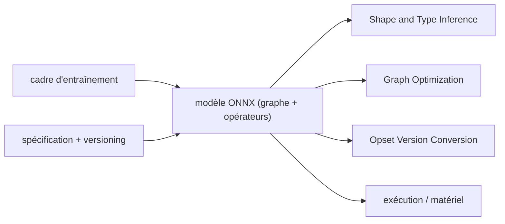

# onnx/onnx

> Open interchange format for AI models, with its operators, types and graph utilities.

## The problem
A model trained in a given framework stays locked into it: moving from research to production,
or changing hardware, requires a rewrite.

## What it actually does
ONNX defines an extensible computation graph model, a set of built-in operators and standard data
types, for deep learning as well as classical ML. The current scope is inference. The Python package
provides graph manipulation utilities: shape and type inference, graph optimization, opset version
conversion. The specification is versioned according to published principles, and the open governance
relies on special interest and working groups. The wheels are abi3, so a single binary wheel covers
Python 3.12 and later.

## How it is wired


## Trying it
```sh
pip install onnx
pip install onnx[reference]
pip install pytest
pytest
```

## Cost and gotchas
Free, Apache-2.0 (SPDX header of the README). The build timestamp is frozen to allow a byte-for-byte
comparison between independent builds — useful for reproducibility, but the README specifies that
this complements provenance attestations without replacing them.
The weekly PyPI packages are for experimentation, not for production.

## What it is not
Not an execution engine: ONNX describes the model, it does not run it. Not a training format —
the project explicitly focuses on inference. Not a universal converter: each framework provides its
own export.

## Alternatives
No alternative is named in the README; it points to the pre-trained ONNX models and the
creation tutorials.

## For you
The format to know as soon as inference has to leave Python — it is already a building block of rembg in this batch.
