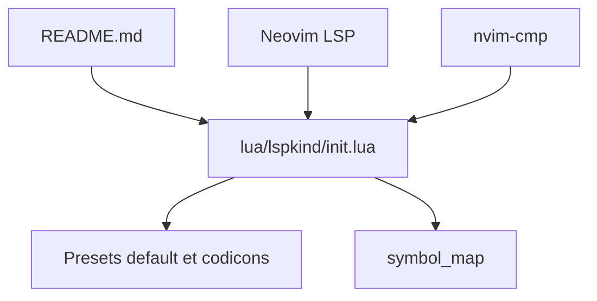

# onsails/lspkind.nvim

> Neovim plugin that adds VS Code-style pictograms to completion menus.

## The problem
A plain-text completion menu makes it hard to tell a method, a variable or a class apart.

## What it actually does
A single file, `lua/lspkind/init.lua`, defines two icon sets (Nerd Fonts, codicons) and an editable `symbol_map` table. It integrates with the native LSP interface, with nvim-cmp via `lspkind.cmp_format` and with blink.cmp.

## How it is wired


## Trying it
```lua
require('lspkind').init({
    mode = 'symbol_text',
    preset = 'codicons',
})
```

## Cost and gotchas
Free. Neovim 0.7 or later and a Nerd Fonts or codicons font. Last push in January 2026.

## What it is not
Not a completion engine: it only dresses up the menus.

## Alternatives
No alternative named in the README.

## For you
Ignore unless you use Neovim: visual comfort, no effect on your data / AI work.
