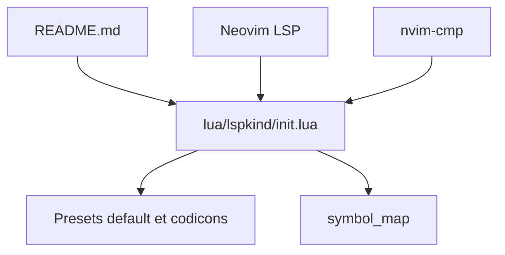

# onsails/lspkind.nvim

> Plugin Neovim qui ajoute des pictogrammes de type VS Code aux menus de complétion.

## Le problème
Un menu de complétion en texte brut rend difficile de distinguer méthode, variable ou classe.

## Ce que ça fait vraiment
Un seul fichier, `lua/lspkind/init.lua`, définit deux jeux d'icônes (Nerd Fonts, codicons) et une table `symbol_map` modifiable. Il s'intègre à l'interface LSP native, à nvim-cmp via `lspkind.cmp_format` et à blink.cmp.

## Comment c'est branché


## Essayer
```lua
require('lspkind').init({
    mode = 'symbol_text',
    preset = 'codicons',
})
```

## Coût et pièges
Gratuit. Neovim 0.7 ou plus et une police Nerd Fonts ou codicons. Dernier push en janvier 2026.

## Ce que ce n'est pas
Ce n'est pas un moteur de complétion : il ne fait qu'habiller les menus.

## Alternatives
Aucune alternative nommée dans le README.

## Pour toi
À ignorer sauf si tu utilises Neovim : confort visuel, sans effet sur ton travail data / IA.

