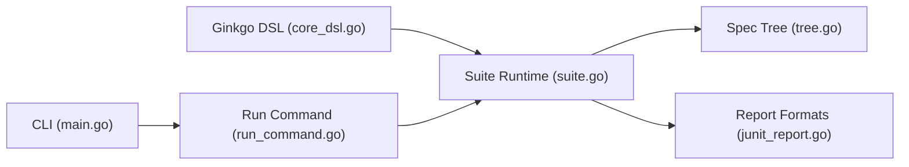

# onsi/ginkgo

> BDD testing framework for Go with a CLI, to be used with the Gomega matcher library.

## The problem
Standard Go tests describe intent poorly, and organizing, filtering and parallelizing large integration suites is laborious.

## What it actually does
Nested DSL (`Describe`, `Context`, `When`, `It`, `BeforeEach`…), reproducible random ordering, parallel execution (`ginkgo -p`), timeouts and cleanup per context, labels for filtering, human-readable or machine reports (JUnit, etc.). CLI to generate, run, profile, plus a `watch` mode. Also provides Claude Code skills via a plugin.

## How it is wired


## Trying it
```bash
ginkgo -p
/plugin marketplace add onsi/ginkgo
/plugin install ginkgo@ginkgo
```

## Cost and gotchas
Free. You need to learn the DSL and Gomega, and follow the parallel spec patterns to avoid shared state.

## What it is not
Not a replacement for `go test`: it builds on it. BDD style that divides the Go community.

## Alternatives
None named in the README (compared with Quick, RSpec, Jasmine, Busted for style).

## For you
Keep an eye on it: relevant only if you write Go (MLOps tools, Kubernetes operators) with large integration suites.
