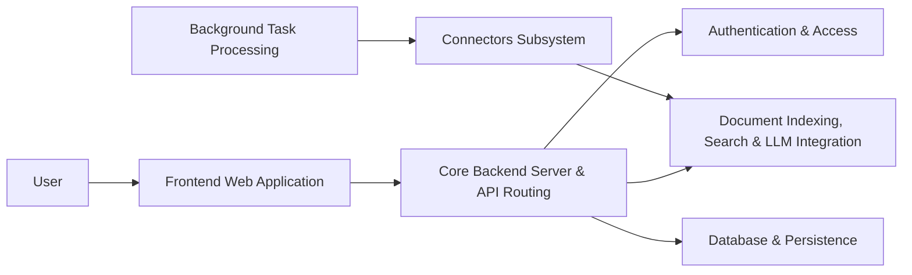

# onyx-dot-app/onyx

> Self-hostable LLM chat platform with RAG over connectors, agents and web search, for teams.

## The problem
Plugging an LLM into company documents, with access rights and cited sources, takes a lot of assembly.

## What it actually does
Next.js frontend, Python backend with 50+ connectors (Drive, Confluence, Slack…) synchronized by Celery workers.
Hybrid vector + keyword indexing (Vespa), agentic RAG, deep research, custom agents, MCP, sandboxed code execution.
Any LLM provider, self-hosted (Ollama, vLLM, LiteLLM) or proprietary.
Lite mode (<1 GB) or Standard (Redis, MinIO, model servers).

## How it is wired


## Trying it
```bash
curl -fsSL https://onyx.app/install_onyx.sh | bash
```

## Cost and gotchas
LLM key at your expense if using a cloud provider; Standard mode is resource-hungry. License not identified by GitHub: the README announces MIT for the CE and a separate Enterprise edition.

## What it is not
SSO/SCIM, fine-grained RBAC, analytics and whitelabel belong to the Enterprise edition. Not a RAG framework to integrate into your code.

## Alternatives
No alternative named in the README.

## For you
Serious candidate for a turnkey internal RAG; check the exact scope of the CE.
