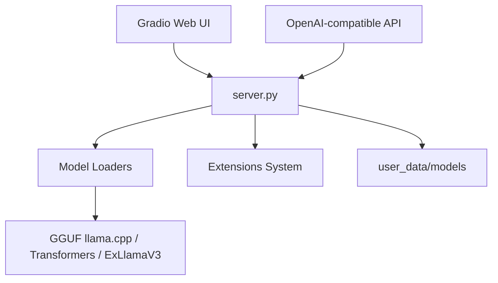

# oobabooga/text-generation-webui

> Desktop app and web interface to run LLMs locally, offline and without telemetry.

## The problem
Loading, comparing and serving local models requires assembling several inference engines.

## What it actually does
Provides chat, notebook, vision, attachments, tool calls and MCP, LoRA training, image generation (diffusers) and an OpenAI- and Anthropic-compatible API. Backends: llama.cpp, ik_llama.cpp, Transformers, ExLlamaV3, TensorRT-LLM. The cited repo has been renamed "textgen". Portable builds (CUDA, Vulkan, ROCm, CPU) or full installation.

## How it is wired


## Trying it
```bash
git clone https://github.com/oobabooga/textgen
cd textgen
python -m venv venv
pip install -r requirements/portable/requirements.txt --upgrade
python server.py --portable --api --auto-launch
```

## Cost and gotchas
Full installation: about 10 GB and a PyTorch download. GPU depending on model size. Single maintainer, with a16z funding mentioned.

## What it is not
Not a large-scale multi-user inference server (multi-user mode targets small trusted teams).

## Alternatives
- No alternative named in the README (it cites AUTOMATIC1111/stable-diffusion-webui as an inspiration).

## For you
Adopt it to experiment with local models: a single interface for several engines, with a compatible API for your scripts.
