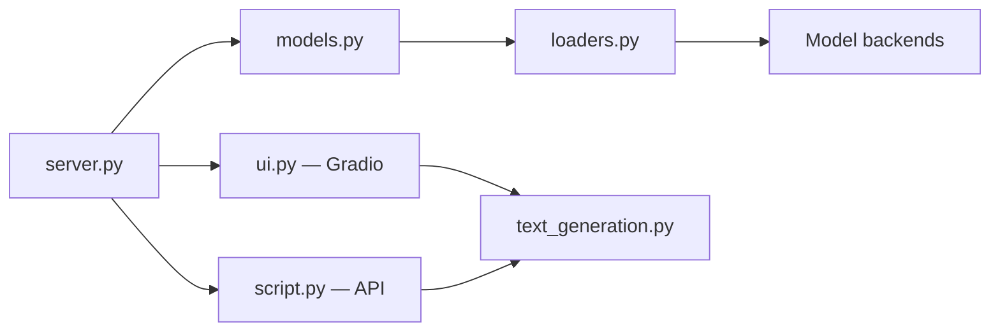

# oobabooga/textgen

> Local application for running LLMs: chat, API compatible with OpenAI/Anthropic, LoRA.

## The problem
Setting up a local LLM involves choosing a backend, prompt templates, and an interface, while ensuring that no data is leaked.

## What it actually does
Models supported: GGUF, Transformers, EXL3 via llama.cpp, ExLlamaV3, Transformers, TensorRT-LLM.
Gradio interface (chat, notebook), attached files, vision, tools in a single `.py` file, MCP.
OpenAI/Anthropic-compatible API; LoRA training; image generation using `diffusers`.
Offline, without telemetry; portable builds and Docker images provided by an accelerator.

## How it is wired


## Trying it
```bash
git clone https://github.com/oobabooga/textgen
cd textgen
python -m venv venv
source venv/bin/activate
pip install -r requirements/portable/requirements.txt --upgrade
python server.py --portable --api --auto-launch
```

## Cost and gotchas
Free; a GPU is recommended, depending on the model. Complete installation: ~10 GB and PyTorch.

## What it is not
Not a multi-user production inference server (`--multi-user` is reserved for small, trusted teams).

## Alternatives
Not documented (AUTOMATIC1111/stable-diffusion-webui cited as inspiration, not as an alternative).

## For you
Ideal for testing local models and a custom API; remember AGPL and the single maintainer.
