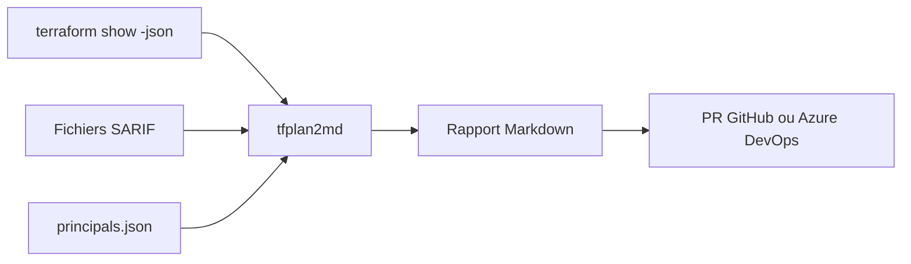

# oocx/tfplan2md

> Converts Terraform plan JSON into a readable Markdown report for pull request reviews.

## The problem
Raw Terraform plans are long and hard to review in a pull request, with hard-to-read index-based diffs.

## What it actually does
Reads `terraform show -json` and produces a report grouped by module with summaries, semantic diffs, masked sensitive values and replacement reasons. Integrates SARIF results from Checkov, Trivy, TFLint and Semgrep. Render targets: GitHub, Azure DevOps, Bitbucket. The README states that the code was written with GitHub Copilot.

## How it is wired


## Trying it
```bash
brew tap oocx/tfplan2md
brew install tfplan2md
docker pull oocx/tfplan2md:latest
terraform show -json plan.tfplan | docker run -i oocx/tfplan2md
terraform show -json plan.tfplan | tfplan2md --render-target github
```

## Cost and gotchas
Free. The Azure identity mapping is prepared by hand (az CLI). Linux binaries require glibc 2.39 minimum; no build for Intel macOS or Windows ARM64.

## What it is not
Not a tool that runs or validates Terraform: it formats a plan that has already been produced. Static analysis comes from third-party tools.

## Alternatives
No alternative named in the README.

## For you
Adopt if you review Terraform plans in CI: it is a simple binary, with no runtime, that makes infrastructure reviews readable.
