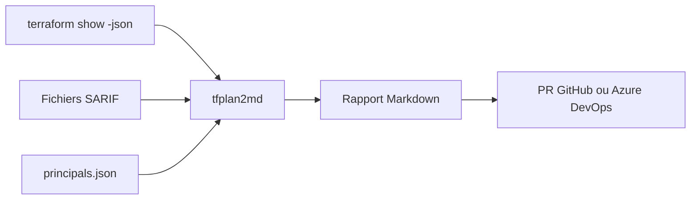

# oocx/tfplan2md

> Convertit le JSON d'un plan Terraform en rapport Markdown lisible pour les revues de pull request.

## Le problème
Les plans Terraform bruts sont longs et difficiles à relire dans une pull request, avec des diffs par index peu lisibles.

## Ce que ça fait vraiment
Lit `terraform show -json` et produit un rapport groupé par module avec résumés, diffs sémantiques, valeurs sensibles masquées et raisons de remplacement. Intègre les résultats SARIF de Checkov, Trivy, TFLint et Semgrep. Cibles de rendu : GitHub, Azure DevOps, Bitbucket. Le README précise que le code a été écrit avec GitHub Copilot.

## Comment c'est branché


## Essayer
```bash
brew tap oocx/tfplan2md
brew install tfplan2md
docker pull oocx/tfplan2md:latest
terraform show -json plan.tfplan | docker run -i oocx/tfplan2md
terraform show -json plan.tfplan | tfplan2md --render-target github
```

## Coût et pièges
Gratuit. Le mapping des identifiants Azure se prépare à la main (az CLI). Binaires Linux glibc 2.39 minimum ; pas de build macOS Intel ni Windows ARM64.

## Ce que ce n'est pas
Pas un outil qui exécute ou valide Terraform : il met en forme un plan déjà produit. L'analyse statique vient d'outils tiers.

## Alternatives
Aucune alternative nommée dans le README.

## Pour toi
À adopter si tu relis des plans Terraform en CI : c'est un binaire simple, sans runtime, qui rend les revues d'infrastructure lisibles.

