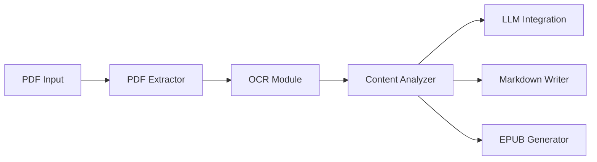

# oomol-lab/pdf-craft

> Python library that converts scanned PDFs into Markdown or EPUB, with optional translation.

## The problem
Scanned books and technical documents are unusable as they are: text, chapters, notes and tables are lost in the image.

## What it actually does
OCR with DeepSeek OCR, DeepSeek OCR 2 or Unlimited OCR, locally (GPU) or via a remote service.
Rebuilds body text, chapters, table of contents, notes, tables, formulas and images.
Outputs Markdown or EPUB; translation by a separate LLM, bilingual EPUB, or translated PDF rewritten onto the pages.
Reusable `.pcex` extraction file to render or translate later.

## How it is wired


## Trying it
```bash
python -m pip install pdf-craft
python -m pip install "pdf-craft[local]"
```

## Cost and gotchas
Poppler required; paid remote OCR and pages sent to a third party, or a CUDA GPU with enough VRAM locally.
Ghostscript and local fonts for the translated PDF; quality depends on the scan.

## What it is not
Not a general-purpose low-level OCR: oriented toward books and long documents.
Not free of hidden costs: translation calls a remote LLM.

## Alternatives
- Wiki Graph: to summarize and build knowledge graphs from the converted books.

## For you
Worth watching: very useful for preparing scanned corpora for RAG; test on a sample before any bulk processing.
