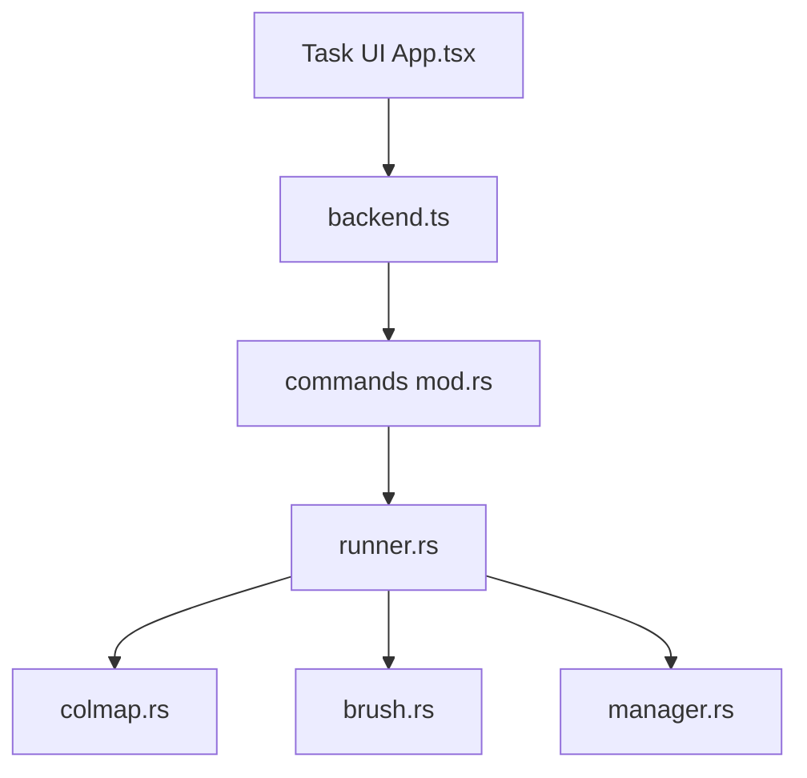

# ooolabdev/ooosplat

> Desktop application that turns videos or photos into a 3D Gaussian Splatting scene, locally.

## The problem
Generating a 3D splat means manually chaining frame extraction, COLMAP reconstruction and training.

## What it actually does
You pick videos or image folders, a project folder and a quality (fast, balanced, fine). The app extracts frames with FFmpeg, reconstructs cameras with COLMAP, trains with Brush, then publishes a final.ply. It previews, edits (selection, deletion, cropping) and exports to PLY, SPZ, SOG, MP4 or HTML. It handles panoramas, GPS, and supplementary captures. A CLI and an optional MCP server exist.

## How it is wired


## Trying it
```bash
npm install
npm run setup:engines
npm run tauri -- dev
sudo apt install ./OOOSplat-0.8.0-x64-linux.deb
```

## Cost and gotchas
Free and local, but a GPU is nearly essential for Brush (Vulkan or Metal); COLMAP benefits from CUDA. Projects take a lot of disk. Anonymous statistics are enabled by default, can be disabled. Windows 11, macOS Apple Silicon and Ubuntu 24.04 in alpha.

## What it is not
Not a cloud service nor a text-to-3D AI generation tool. The resume-project screen does not restore the optimizer.

## Alternatives
No alternative named in the README (COLMAP and Brush are components).

## For you
Worth watching: interesting if you explore local 3D reconstruction with a GPU, but still alpha and creation-oriented rather than MLOps.
