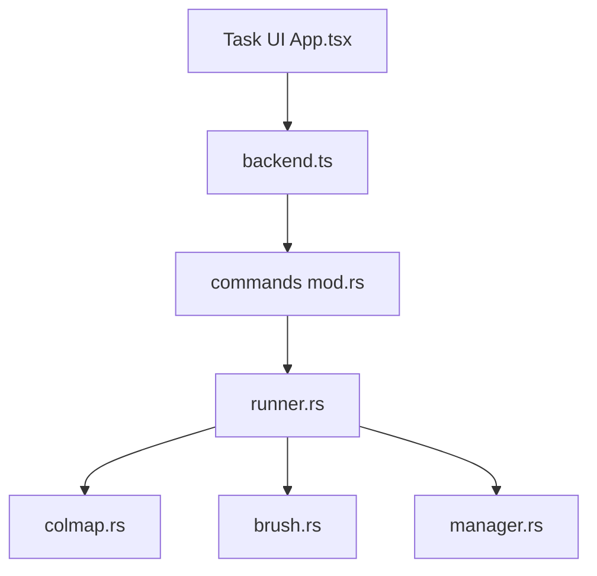

# ooolabdev/ooosplat

> Application de bureau qui transforme vidéos ou photos en scène 3D Gaussian Splatting, en local.

## Le problème
Générer un splat 3D oblige à enchaîner à la main extraction d'images, reconstruction COLMAP et entraînement.

## Ce que ça fait vraiment
Tu choisis des vidéos ou dossiers d'images, un dossier de projet et une qualité (rapide, équilibré, fin). L'app extrait les images avec FFmpeg, reconstruit les caméras avec COLMAP, entraîne avec Brush, puis publie un final.ply. Elle prévisualise, édite (sélection, suppression, recadrage) et exporte en PLY, SPZ, SOG, MP4 ou HTML. Elle gère les panoramas, le GPS, les compléments de prise de vue. Un CLI et un serveur MCP optionnel existent.

## Comment c'est branché


## Essayer
```bash
npm install
npm run setup:engines
npm run tauri -- dev
sudo apt install ./OOOSplat-0.8.0-x64-linux.deb
```

## Coût et pièges
Gratuit et local, mais un GPU est quasi indispensable pour Brush (Vulkan ou Metal) ; COLMAP profite de CUDA. Les projets prennent beaucoup de disque. Statistiques anonymes activées par défaut, désactivables. Windows 11, macOS Apple Silicon et Ubuntu 24.04 en alpha.

## Ce que ce n'est pas
Pas un service cloud ni un outil de génération par IA texte-vers-3D. L'écran reprend un projet sans restaurer l'optimiseur.

## Alternatives
Aucune alternative nommée dans le README (COLMAP et Brush sont des composants).

## Pour toi
À surveiller : intéressant si tu explores la reconstruction 3D en local avec GPU, mais encore en alpha et orienté création plutôt que MLOps.

