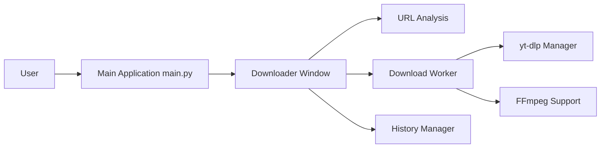

# oop7/YTSage

> PySide6 interface around yt-dlp to download videos, audio and subtitles.

## The problem
yt-dlp is powerful but command-line only; you want to choose formats and playlists in an interface.

## What it actually does
The GUI analyzes a URL, shows the format table, launches yt-dlp through a worker, then applies audio conversions, subtitles, SponsorBlock and trimming. Local database history, browser cookies, proxy, generic mode for other sites, and built-in updates of yt-dlp, FFmpeg and Deno.

## How it is wired


## Trying it
```bash
pip install ytsage
ytsage
ytsage "https://www.youtube.com/watch?v=dQw4w9WgXcQ"
```

## Cost and gotchas
Free. Python 3.11 or later, FFmpeg required. Windows installers may be flagged by antivirus (false positive according to the README). The README reminds users to respect YouTube's terms.

## What it is not
It is not a download engine: it depends on the installed yt-dlp version. "Modern" and "clean" are the README's own adjectives.

## Alternatives
- yt-dlp: the engine, on the command line.

## For you
Worth watching: handy for fetching videos or subtitles into a corpus, while respecting platform terms; mere comfort otherwise.
