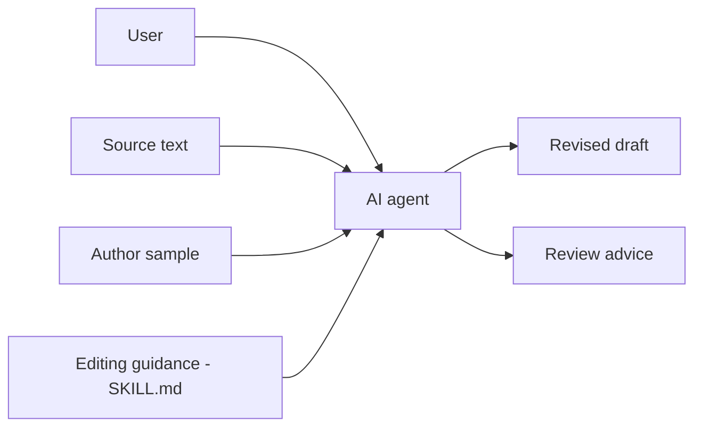

# op7418/Humanizer-zh

> Coding agent skill that rewrites Chinese texts by removing typical AI phrasing.

## The problem
AI-generated texts keep tics: lists of three, hollow phrasing, closing formulas.

## What it actually does
A `SKILL.md` applied by the agent to pasted text or a file: 31 checkpoints (categories A to F) to remove the tics, with explicit constraints: do not invent data, keep modality and uncertain wording, respect the register. Review-only mode is possible, and an author sample to mimic the voice.

## How it is wired


## Trying it
```bash
npx skills add https://github.com/op7418/Humanizer-zh.git
git clone https://github.com/op7418/Humanizer-zh.git ~/.claude/skills/humanizer-zh
```
Then `/humanizer-zh` in Claude Code.

## Cost and gotchas
Free, but consumes the agent's context and tokens. The README admits the evaluation is based on limited samples.

## What it is not
Not an AI detector nor a standalone program: these are instructions for an agent. Specific to Chinese.

## Alternatives
- blader/humanizer: original project (v3.0.0), not Chinese.
- hardikpandya/stop-slop: concise style reference.

## For you
Ignore: useful only if you write in Chinese; outside the French-speaking data/AI/MLOps profile.
