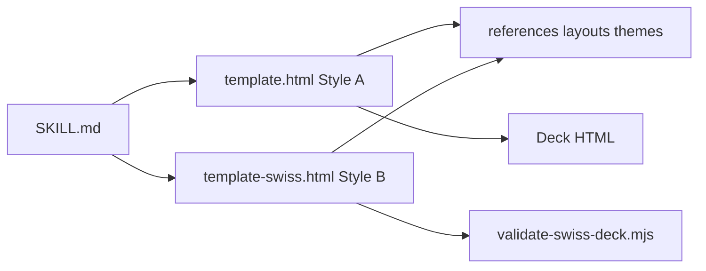

# op7418/guizang-ppt-skill

> Skill for Claude Code or Codex that generates single-file HTML presentations, with presenter mode and covers.

## The problem
Making a polished, consistent deck with an agent means reinventing the layout every time.

## What it actually does
Two visual systems: Style A (magazine, e-ink, 10 layouts) and Style B (Swiss, 22 locked versions, 4 anchor colors). Produces a single HTML file, opened directly in the browser. Built-in presenter mode: dual window, notes, timer, rehearsal. Node validators for the Swiss style and presenter mode. Optional image generation under Codex and multi-platform covers.

## How it is wired


## Trying it
```bash
npx skills add https://github.com/op7418/guizang-ppt-skill --skill guizang-ppt-skill
node scripts/validate-swiss-deck.mjs path/to/index.html
node scripts/validate-presenter-mode.mjs path/to/index.html
```

## Cost and gotchas
Free; image generation depends on the agent (Codex). Colors are limited to presets, with no free hex. README mostly in Chinese. AGPL-3.0 license: sharing obligations if you redistribute or host it.

## What it is not
Not a PowerPoint export (the README says PPTX is not the main flow). Not suited to dense tables, training, or collaborative editing.

## Alternatives
No alternative named in the README.

## For you
Worth watching: useful for demo or sharing presentations, not for core data work; the AGPL license and single maintainer weigh in if you integrate it into a product.
