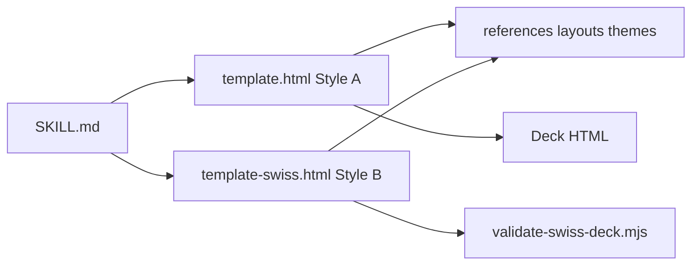

# op7418/guizang-ppt-skill

> Skill pour Claude Code ou Codex qui génère des présentations HTML en un fichier, avec mode orateur et covers.

## Le problème
Faire un deck soigné et cohérent avec un agent oblige à réinventer la mise en page à chaque fois.

## Ce que ça fait vraiment
Deux systèmes visuels : Style A (magazine, encre électronique, 10 mises en page) et Style B (suisse, 22 versions verrouillées, 4 couleurs d'ancrage). Produit un HTML unique, ouvert directement dans le navigateur. Mode orateur intégré : double fenêtre, notes, chronomètre, répétition. Validateurs Node pour le style suisse et le mode orateur. Option de génération d'images sous Codex et de couvertures multi-plateformes.

## Comment c'est branché


## Essayer
```bash
npx skills add https://github.com/op7418/guizang-ppt-skill --skill guizang-ppt-skill
node scripts/validate-swiss-deck.mjs path/to/index.html
node scripts/validate-presenter-mode.mjs path/to/index.html
```

## Coût et pièges
Gratuit ; la génération d'images dépend de l'agent (Codex). Les couleurs sont limitées à des préréglages, sans hex libre. README principalement en chinois. Licence AGPL-3.0 : obligations de partage si tu redistribues ou héberges.

## Ce que ce n'est pas
Pas un export PowerPoint (le README dit que PPTX n'est pas le flux principal). Pas adapté aux tableaux denses, à la formation ni à l'édition collaborative.

## Alternatives
Aucune alternative nommée dans le README.

## Pour toi
À surveiller : sert à des présentations de démo ou de partage, pas à un travail data central ; la licence AGPL et le mainteneur unique pèsent si tu l'intègres à un produit.

