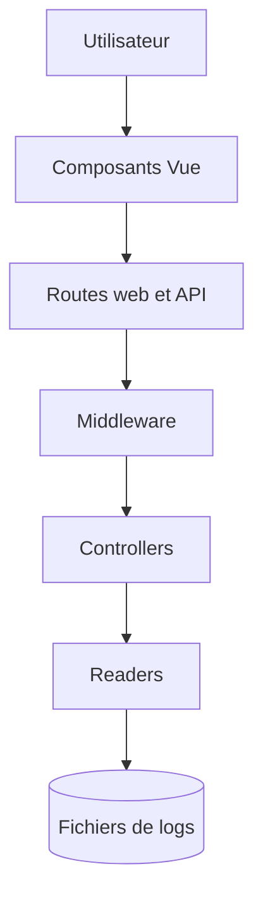

# opcodesio/log-viewer

> Web interface to read, search and filter the logs of a Laravel application.

## The problem
Reading raw Laravel log files to track down an error is tedious.

## What it actually does
A Composer package that adds a `/log-viewer` page: list of the files in `storage/logs`, search, filtering by level, shareable links, dark mode, API access, email preview and support for other logs (Horizon, Apache, Nginx, Redis, Postgres). Works with PHP 8.0+ and Laravel 8+.

## How it is wired


## Trying it
```bash
composer require opcodesio/log-viewer
php artisan log-viewer:publish
```

## Cost and gotchas
Free. The web process must have permission to read the logs. A custom log format requires a custom parser.

## What it is not
It is not a multi-service log aggregation tool, nor an observability platform. It only serves Laravel applications (or locally readable files).

## Alternatives
No alternative named in the README.

## For you
Ignore: excellent for Laravel, but unrelated to a data / AI / MLOps profile unless you maintain a PHP application.
