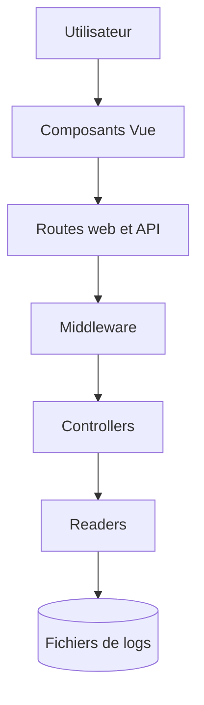

# opcodesio/log-viewer

> Interface web pour lire, chercher et filtrer les journaux d'une application Laravel.

## Le problème
Lire les fichiers de logs bruts de Laravel pour retrouver une erreur est fastidieux.

## Ce que ça fait vraiment
Paquet Composer qui ajoute une page `/log-viewer` : liste des fichiers de `storage/logs`, recherche, filtre par niveau, liens partageables, mode sombre, accès API, aperçu des e-mails et prise en charge d'autres journaux (Horizon, Apache, Nginx, Redis, Postgres). Fonctionne avec PHP 8.0+ et Laravel 8+.

## Comment c'est branché


## Essayer
```bash
composer require opcodesio/log-viewer
php artisan log-viewer:publish
```

## Coût et pièges
Gratuit. Le processus web doit avoir le droit de lire les logs. Un format de log personnalisé demande un analyseur sur mesure.

## Ce que ce n'est pas
Ce n'est pas un outil d'agrégation de logs multi-services, ni une plateforme d'observabilité. Il ne sert qu'aux applications Laravel (ou fichiers lisibles localement).

## Alternatives
Aucune alternative nommée dans le README.

## Pour toi
Ignorer : excellent pour Laravel, mais sans lien avec un profil data / IA / MLOps sauf si tu maintiens une application PHP.

