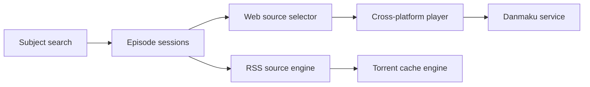

# open-ani/animeko

> Cross-platform application for tracking and watching anime, with Bangumi sync and danmaku.

## The problem
Tracking your series, recovering your progress and aggregating video sources and comments.

## What it actually does
Browses Bangumi entries, syncs progress, aggregates sources (BitTorrent, Jellyfin, Emby, custom online sources), plays with ExoPlayer (Android) or VLC (PC), displays scrolling comments (danmaku) via dandanplay and its own server, and caches offline through a libtorrent engine. Kotlin Multiplatform and Compose.

## How it is wired

## Trying it
No command in the README (in Chinese): download the stable or test version from the releases.

## Cost and gotchas
Free. With BT, the app automatically shares (seeds). Depends on Bangumi and a community danmaku server.

## What it is not
Hosts no video: the README states that everything comes from the network. Using third-party sources carries legal risk depending on the country.

## Alternatives
None named in the README.

## For you
Ignore: a consumer anime player, unrelated to data / AI work.
