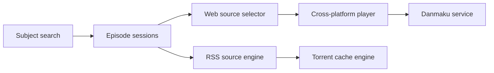

# open-ani/animeko

> Application multiplateforme pour suivre et regarder des animés, avec sync Bangumi et danmaku.

## Le problème
Suivre ses séries, retrouver sa progression et agréger sources vidéo et commentaires.

## Ce que ça fait vraiment
Parcourt les fiches Bangumi, synchronise la progression, agrège des sources (BitTorrent, Jellyfin, Emby, sources en ligne personnalisées), joue avec ExoPlayer (Android) ou VLC (PC), affiche des commentaires défilants (danmaku) via dandanplay et un serveur propre, et met en cache hors ligne via un moteur libtorrent. Kotlin Multiplatform et Compose.

## Comment c'est branché

## Essayer
Aucune commande dans le README (en chinois) : téléchargement de la version stable ou de test depuis les releases.

## Coût et pièges
Gratuit. En BT, l'appli partage automatiquement (seed). Dépend de Bangumi et d'un serveur de danmaku communautaire.

## Ce que ce n'est pas
N'héberge aucune vidéo : le README précise que tout vient du réseau. Usage de sources tierces à risque juridique selon le pays.

## Alternatives
Aucune nommée dans le README.

## Pour toi
Ignorer : un lecteur d'animés grand public, sans lien avec le travail data / IA.

