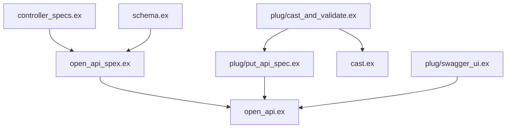

# open-api-spex/open_api_spex

> Generates, validates and documents an OpenAPI 3 specification from Elixir code, for Plug and Phoenix APIs.

## The problem
In an Elixir API, documentation, request validation and code quickly drift apart.

## What it actually does
Schemas and ControllerSpecs feed the OpenAPI spec. Plugs serve it as JSON and through SwaggerUI, cast and validate parameters before the controller (422 response on error), and test assertions check responses against the schemas. An import from an existing JSON or YAML file exists, with a warning about converting strings to atoms.

## How it is wired


## Trying it
```bash
mix openapi.spec.json --spec MyAppWeb.ApiSpec
mix openapi.spec.yaml --spec MyAppWeb.ApiSpec
```
Dependency to add in mix.exs: `{:open_api_spex, "~> 3.21"}`.

## Cost and gotchas
Free. Requires Elixir and a Phoenix or Plug project (not listed in the prerequisites). SwaggerUI assets come from cdnjs.cloudflare.com; the YAML format requires the ymlr dependency.

## What it is not
Not a tool for Python or another language: it is tied to Elixir. The default error renderer has a formatting flaw, worked around with `json_render_error_v2: true` until version 4.0.

## Alternatives
No alternative cited in the README.

## For you
Worth watching: useful only if you expose an inference service in Elixir/Phoenix; outside that stack, it brings nothing.
