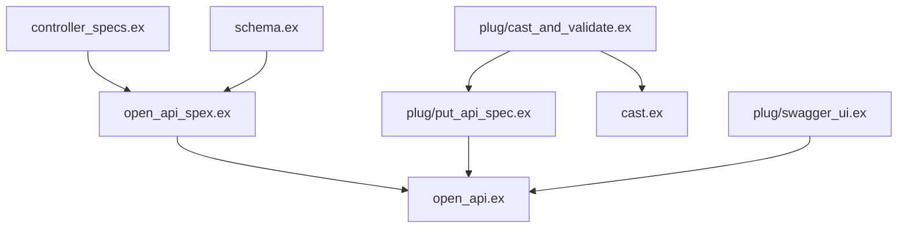

# open-api-spex/open_api_spex

> Génère, valide et documente une spécification OpenAPI 3 depuis le code Elixir, pour les API Plug et Phoenix.

## Le problème
Dans une API Elixir, la documentation, la validation des requêtes et le code dérivent vite l'un de l'autre.

## Ce que ça fait vraiment
Les schémas et les ControllerSpecs alimentent la spec OpenAPI. Des plugs la servent en JSON et via SwaggerUI, castent et valident les paramètres avant le contrôleur (réponse 422 en cas d'erreur), et des assertions de test vérifient les réponses contre les schémas. Un import depuis un fichier JSON ou YAML existe, avec un avertissement sur la conversion de chaînes en atomes.

## Comment c'est branché


## Essayer
```bash
mix openapi.spec.json --spec MyAppWeb.ApiSpec
mix openapi.spec.yaml --spec MyAppWeb.ApiSpec
```
Dépendance à ajouter dans mix.exs : `{:open_api_spex, "~> 3.21"}`.

## Coût et pièges
Gratuit. Nécessite Elixir et un projet Phoenix ou Plug (non listé dans les prérequis). Les assets SwaggerUI viennent de cdnjs.cloudflare.com ; le format YAML demande la dépendance ymlr.

## Ce que ce n'est pas
Pas un outil pour Python ou autre langage : il est lié à Elixir. Le renderer d'erreur par défaut a un défaut de format, contourné par `json_render_error_v2: true` jusqu'à la version 4.0.

## Alternatives
Aucune alternative citée dans le README.

## Pour toi
Surveiller : utile seulement si tu exposes un service d'inférence en Elixir/Phoenix ; hors de cette pile, il n'apporte rien.

