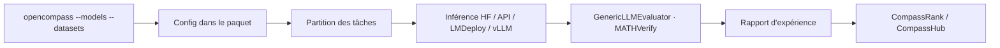

# open-compass/opencompass

> LLM evaluation platform: 70+ datasets, local and API models on the same footing.

## The problem
Comparing two models honestly requires the same datasets, the same prompts, the same scoring method — and being able to rerun everything later identically.

## What it actually does
A command line or a Python script describes models and datasets; the same syntax covers a local HuggingFace model and an API model. Zero-shot, few-shot and chain-of-thought evaluations, with standard prompt templates or dialogue. Automatic task partitioning and distributed evaluation. LMDeploy or vLLM acceleration backends via `-a`. Recent evaluators: `GenericLLMEvaluator` for LLM-as-judge, `MATHVerifyEvaluator` for mathematical reasoning, `CascadeEvaluator` to chain several evaluators. VLMEvalKit integration for multimodal, and a tool to analyze repetitive outputs.

## How it is wired


## Trying it
```bash
conda create --name opencompass python=3.12 -y
pip install -U opencompass
opencompass --models hf_internlm2_5_1_8b_chat --datasets demo_gsm8k_chat_gen
opencompass --models hf_internlm2_5_1_8b_chat --datasets demo_gsm8k_chat_gen -a lmdeploy
python tools/list_configs.py llama mmlu
wget https://github.com/open-compass/opencompass/releases/download/0.2.2.rc1/OpenCompassData-core-20240207.zip
```

## Cost and gotchas
Free, but evaluating costs: GPU for local models, tokens for API models (`OPENAI_API_KEY`). Breaking change in 0.4.0: all configuration files migrate into the package, external references break. Python 3.12 in general, but **3.10 is mandatory** if you use the code-execution datasets backed by `pyext` — otherwise APPS, TACO and LiveCodeBench Code Generation are unavailable.

## What it is not
It is not a neutral turnkey ranking: submitting to the leaderboard goes through an email to the team. It is not a training tool.

## Alternatives
- **VLMEvalKit**: cited as an integration, for official multimodal metrics.

## For you
The tool to know whenever you need to justify a model choice with reproducible numbers.
