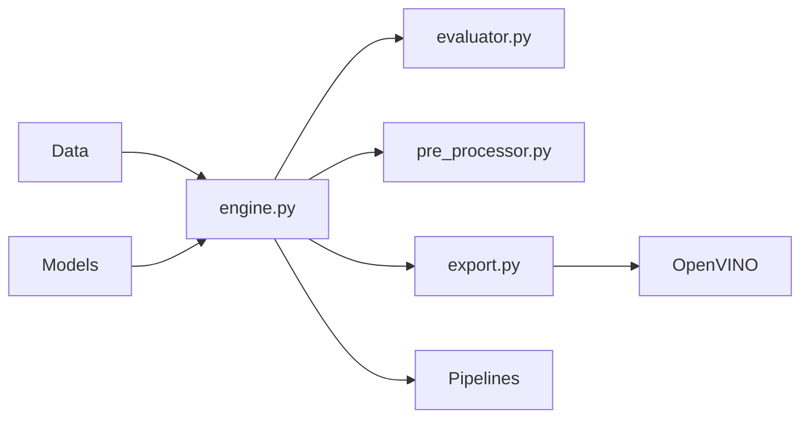

# open-edge-platform/anomalib

> PyTorch Lightning library of visual anomaly detection algorithms, from training to deployment.

## The problem
Reimplementing and comparing PatchCore, PaDiM or STFPM on your own industrial images takes weeks, and moving to production is a project of its own.

## What it actually does
Collection of image and video models (torch + lightning) with datamodules for MVTec, Visa, BTech…
A single `Engine` to train, predict, benchmark and run HPO (W&B, Comet).
OpenVINO export and Torch/OpenVINO inferencers; Intel XPU GPU support.
Anomalib Studio (preview): low-code web app, cameras, MQTT/webhook outputs.

## How it is wired


## Trying it
```bash
pip install anomalib
anomalib train --model Patchcore --data anomalib.data.MVTecAD
anomalib predict --model anomalib.models.Patchcore --data anomalib.data.MVTecAD --ckpt_path path/to/model.ckpt
anomalib benchmark --config tools/experimental/benchmarking/sample.yaml
```

## Cost and gotchas
Free; a GPU is recommended, and the PyTorch backend must be chosen at install time (cpu, cu130, xpu). `Tabular.from_file()` now refuses pickle and hdf.

## What it is not
Not an anomaly detection tool for tabular or time-series data: the focus is visual. Studio is an unstable preview.

## Alternatives
No alternative named in the README.

## For you
Adopt for any visual quality-control use case: an Intel-maintained reference, a familiar Lightning API and an export path already built.
