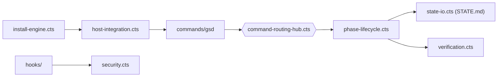

# open-gsd/gsd-core

> Spec-driven development framework that runs coding agents in a loop of phases.

## The problem
The more an agent's context window fills up, the more its output degrades; from one session to the next it retains nothing, and nobody checks that the code works.

## What it actually does
Installs slash commands, skills, agents and hooks into the host (Claude Code, Codex, OpenCode, Cursor, Copilot…).
Each phase follows five steps: discuss, plan, execute, verify, ship (PR). Most of the work goes to fresh-context subagents (200k tokens each), in parallel waves, isolated in Git worktrees.
State survives between sessions in `STATE.md`, `CONTEXT.md`, roadmap and plans.
Hooks monitor context, guard worktree paths, validate commits and filter prompt injection.

## How it is wired


## Trying it
```bash
npx @opengsd/gsd-core@latest
# puis, dans l'agent :
# /gsd-new-project   (nouveau projet)
# /gsd-onboard       (code existant)
```

## Cost and gotchas
You need Node and a coding agent with its subscription or key. 200k-token subagents launched in parallel waves burn through the quota quickly. Use the installer: copying `agents/` or `commands/` by hand is not supported.

## What it is not
Not an application nor a service: a layer of prompts, commands and hooks on top of the agent you already use.
Does not guarantee quality: the "verify" step is a guided walkthrough followed by fix plans, not a proof.

## Alternatives
No alternative named in the README.

## For you
Test on a new project if your long sessions drift; measure token consumption first.
