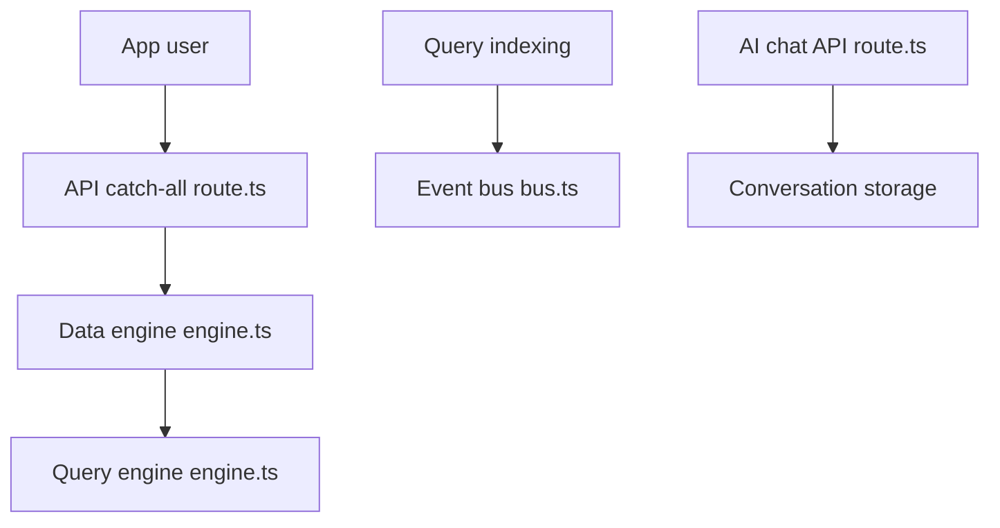

# open-mercato/open-mercato

> A TypeScript framework on Next.js and PostgreSQL that ships CRM, ERP and commerce, with rules for coding agents.

## The problem
Coding assistants generate files without knowing where to put them or how to stay consistent across a team. And a back office gets rebuilt for every project.

## What it actually does
A generated application contains business modules (customers, catalog, sales, warehouse, portal, workflows) and an `AGENTS.md` file with skills that tell the agent where to place code. Specifications live in `.ai/specs/`. Cezar, an open-source IDE, runs tasks in git worktrees. Enterprise modules are under a separate license.

## How it is wired
Diagram taken from the code, simplified.



## Trying it
```bash
npx create-mercato-app my-app --preset classic --agents all --init-git
cd my-app
yarn setup
npx cezar-run
```

## Cost and gotchas
Docker, about 8 GB of free RAM, PostgreSQL 15+ (Redis and Meilisearch optional). The hosted cloud is a beta requiring an account. A Railway deployment requires an account and a token.

## What it is not
Not a data science tool: it is a foundation for business applications. The `packages/enterprise/` folder is closed to external contributors and its modules are not MIT.

## Alternatives
No alternative named in the README.

## For you
Worth watching: interesting as an example of a harness for coding agents (skills, specs, guardrails), less so as an ERP for a data and AI profile.
