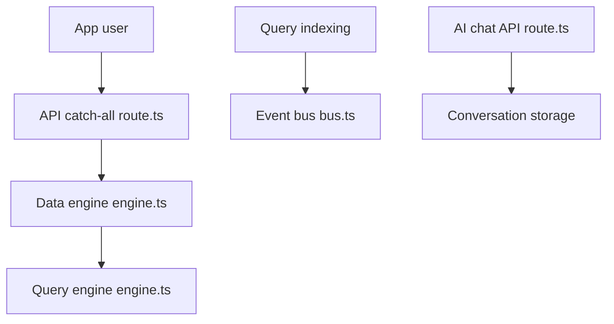

# open-mercato/open-mercato

> Un framework TypeScript sur Next.js et PostgreSQL qui livre CRM, ERP et commerce, avec règles pour agents de code.

## Le problème
Les assistants de code génèrent des fichiers sans savoir où les ranger ni comment rester cohérent dans une équipe. Et un back-office se refait à chaque projet.

## Ce que ça fait vraiment
Une application générée contient des modules métier (clients, catalogue, ventes, entrepôt, portail, workflows) et un fichier `AGENTS.md` avec des skills qui disent à l'agent où placer le code. Les spécifications vivent dans `.ai/specs/`. Cezar, un IDE open source, lance les tâches dans des worktrees git. Les modules enterprise sont sous licence séparée.

## Comment c'est branché
Diagramme tiré du code, simplifié.



## Essayer
```bash
npx create-mercato-app my-app --preset classic --agents all --init-git
cd my-app
yarn setup
npx cezar-run
```

## Coût et pièges
Docker, environ 8 Go de RAM libres, PostgreSQL 15+ (Redis et Meilisearch en option). Le cloud hébergé est une bêta avec compte requis. Un déploiement Railway demande un compte et un jeton.

## Ce que ce n'est pas
Pas un outil de data science : c'est un socle d'applications métier. Le dossier `packages/enterprise/` est fermé aux auteurs externes et ses modules ne sont pas MIT.

## Alternatives
Aucune alternative nommée dans le README.

## Pour toi
À surveiller : intéressant comme exemple de harnais pour agents de code (skills, specs, garde-fous), moins comme ERP pour un profil data et IA.

