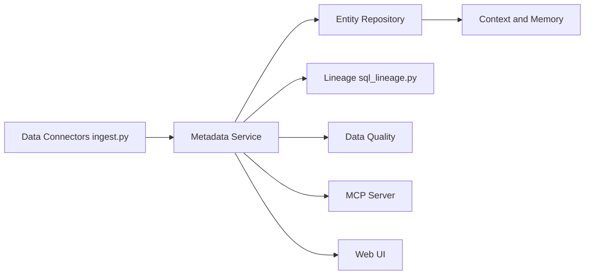

# open-metadata/OpenMetadata

> Open source metadata catalog with lineage, quality, governance and an MCP server for agents.

## The problem
Data teams do not know what tables mean, who owns them, whether they are reliable, or what a change will break.

## What it actually does
More than 130 connectors ingest metadata from warehouses, BI, pipelines and ML into a graph: lineage (down to the column), quality tests, glossaries, data contracts (ODCS), owners. Access is through UI, API, Python/TS/Java SDKs, semantic search and an MCP server; "memories" keep decisions and notes tied to assets.

## How it is wired


## Trying it
```bash
pip install "openmetadata-ingestion"
pip install data-ai-sdk
```
An online sandbox and an installation guide are pointed to in the README.

## Cost and gotchas
Open source, but a platform you must host (server, database, search engine). AI agents, AI Studio and support belong to the commercial Collate offering.

## What it is not
Not a warehouse nor an orchestration tool: it describes data, it does not transform it.

## Alternatives
No alternative named in the README.

## For you
Adopt to govern a fleet of tables: lineage and MCP make it a good context base for agents, provided you take on the operations.
