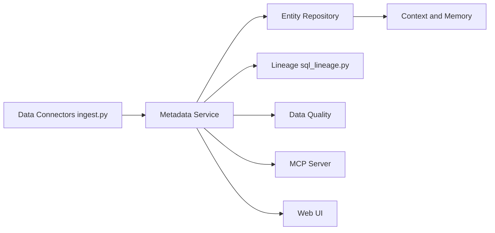

# open-metadata/OpenMetadata

> Catalogue de métadonnées open source avec lignage, qualité, gouvernance et serveur MCP pour agents.

## Le problème
Les équipes données ne savent pas ce que signifient les tables, qui les possède, si elles sont fiables, ni ce qu'un changement casse.

## Ce que ça fait vraiment
Plus de 130 connecteurs ingèrent les métadonnées d'entrepôts, BI, pipelines et ML dans un graphe : lignage (jusqu'à la colonne), tests de qualité, glossaires, contrats de données (ODCS), propriétaires. L'accès se fait par UI, API, SDK Python/TS/Java, recherche sémantique et serveur MCP ; des « mémoires » conservent décisions et notes liées aux actifs.

## Comment c'est branché


## Essayer
```bash
pip install "openmetadata-ingestion"
pip install data-ai-sdk
```
Un bac à sable en ligne et un guide d'installation sont indiqués dans le README.

## Coût et pièges
Open source, mais plateforme à héberger (serveur, base, moteur de recherche). Les agents IA, AI Studio et le support relèvent de l'offre commerciale Collate.

## Ce que ce n'est pas
Pas un entrepôt ni un outil d'orchestration : il décrit les données, il ne les transforme pas.

## Alternatives
Aucune alternative nommée dans le README.

## Pour toi
Adopter pour gouverner un parc de tables : lignage et MCP en font une bonne base de contexte pour agents, à condition d'assumer l'exploitation.

