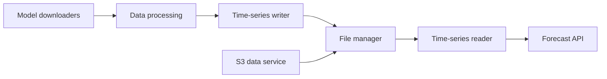

# open-meteo/open-meteo

> Open weather API with no key required, self-hostable, for developers and data scientists who want forecasts and historical data.

## The problem
National weather services' forecasts are public but come in binary formats, grids and projections that require real expertise. Without an intermediary, using them is costly.

## What it actually does
Every day it downloads more than 5 TB of models (NOAA GFS/HRRR, DWD ICON, MeteoFrance, ECMWF IFS, JMA, GEM, MET Norway), stores them in a custom file format optimized for time series, then serves JSON APIs: forecasts up to 16 days, 80 years of history, marine, air quality, floods, geocoding, elevation. No API key, CORS allowed, no cookies.

## How it is wired


## Trying it
```bash
curl "https://api.open-meteo.com/v1/forecast?latitude=52.52&longitude=13.41&hourly=temperature_2m"
```

## Cost and gotchas
The API is free for non-commercial use (CC BY 4.0); contact them beyond 10,000 requests per day or for commercial use. Self-hosting goes through Docker or the Ubuntu 22.04 package.

## What it is not
It is not a royalty-free API for commercial use: only the code is under AGPLv3, and the hosted instance has its own terms. Nor is it a weather model: it redistributes those of national services.

## Alternatives
No alternative named in the README; it lists SDKs (Python, TypeScript, Go, Rust, R) for calling it.

## For you
Adopt: a free, key-less source of weather variables for ML features or pipelines, while checking the non-commercial framework.
