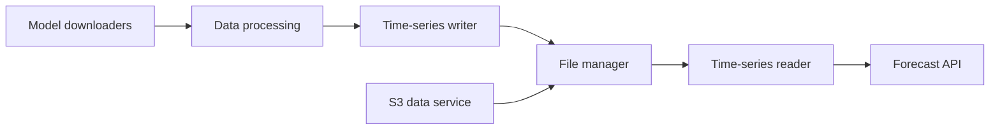

# open-meteo/open-meteo

> API météo ouverte sans clé, auto-hébergeable, pour développeurs et data scientists qui veulent prévisions et historiques.

## Le problème
Les prévisions des services météo nationaux sont publiques mais en formats binaires, grilles et projections exigeant une vraie expertise. Sans intermédiaire, les exploiter coûte cher.

## Ce que ça fait vraiment
Télécharge chaque jour plus de 5 To de modèles (NOAA GFS/HRRR, DWD ICON, MeteoFrance, ECMWF IFS, JMA, GEM, MET Norway), les range dans un format de fichier maison optimisé pour les séries temporelles, puis sert des API JSON : prévisions jusqu'à 16 jours, historique sur 80 ans, marine, qualité de l'air, inondations, géocodage, altitude. Pas de clé d'API, CORS permis, aucun cookie.

## Comment c'est branché


## Essayer
```bash
curl "https://api.open-meteo.com/v1/forecast?latitude=52.52&longitude=13.41&hourly=temperature_2m"
```

## Coût et pièges
API gratuite pour usage non commercial (CC BY 4.0), à contacter au-delà de 10 000 requêtes par jour ou pour un usage commercial. L'auto-hébergement passe par Docker ou le paquet Ubuntu 22.04.

## Ce que ce n'est pas
Ce n'est pas une API libre de droits pour le commerce : seul le code est en AGPLv3, l'instance hébergée a ses conditions. Ce n'est pas non plus un modèle météo : il redistribue ceux des services nationaux.

## Alternatives
Aucune alternative nommée dans le README ; il liste des SDK (Python, TypeScript, Go, Rust, R) pour l'appeler.

## Pour toi
Adopter : source de variables météo gratuite et sans clé pour des features ML ou des pipelines, en vérifiant le cadre non commercial.

