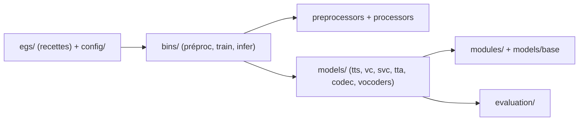

# open-mmlab/Amphion

> Research toolkit for generating speech, singing and audio, with vocoders, codecs and metrics.

## The problem
Reproducing speech synthesis and voice conversion models means reassembling data, training and evaluation.

## What it actually does
Per-task models: TTS (FastSpeech2, VITS, VALL-E, NaturalSpeech2, Jets, MaskGCT, Vevo), voice and accent conversion, singing voice conversion, text-to-audio, codecs (DualCodec, FACodec), GAN/flow/diffusion vocoders. It adds evaluation metrics (F0, WER, FAD, PESQ, speaker similarity), dataset preprocessing including Emilia, and the SingVisio visualization tool. Each task is driven by recipes in `egs/`.

## How it is wired


## Trying it
```bash
git clone https://github.com/open-mmlab/Amphion.git
cd Amphion
conda create --name amphion python=3.9.15
conda activate amphion
sh env.sh
docker pull realamphion/amphion
```

## Cost and gotchas
GPU and Docker with the NVIDIA Container Toolkit for the image; Python 3.9.15 is mandatory. Datasets are mounted with `-v`. Third-party pretrained weights are not detailed in the README.

## What it is not
Not a ready-to-use application: it is a framework for research and teaching. Text-to-music is still "under development".

## Alternatives
No alternative named in the README.

## For you
Worth watching: a useful reference for studying or reproducing audio models, but heavy to install, GPU-only, and its last push dates from March 2026.
