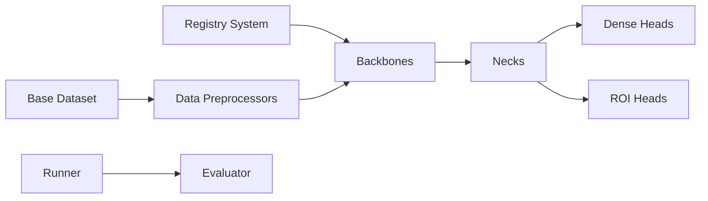

# open-mmlab/mmdetection

> Modular PyTorch toolbox for object detection and segmentation, aimed at vision researchers.

## The problem
Comparing or combining detection architectures requires reimplementing backbones, necks, heads and training loops.

## What it actually does
Detectors assembled through configuration from registered components (registry): backbones, necks, dense/ROI heads.
Detection, instance and panoptic segmentation, semi-supervised detection; dozens of methods (Faster R-CNN, DETR, DINO, RTMDet, Mask2Former…).
Model zoo of pre-trained weights; MM-Grounding-DINO (v3.3.0, January 2024).
Built on MMEngine (training) and MMCV.

## How it is wired

## Trying it
No command documented in the README (installation is deferred to the documentation).

## Cost and gotchas
GPU for training; MMCV/MMEngine dependencies are sensitive to PyTorch versions. Last push in August 2024, 1,962 open issues.

## What it is not
Not a turnkey detection tool: you need to master the config system. No longer actively developed.

## Alternatives
- Detectron2: cited as a baseline for speed comparison.
- MMYOLO: YOLO family within the same ecosystem.
- MMDeploy: for model deployment.

## For you
Useful for reproducing a paper; for a new project, check PyTorch compatibility first.
