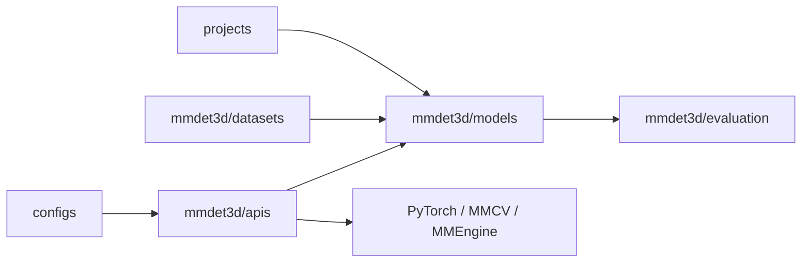

# open-mmlab/mmdetection3d

> PyTorch toolbox for 3D object detection (LiDAR, camera, fusion) from the OpenMMLab ecosystem.

## The problem
Comparing or training 3D detectors means reimplementing heterogeneous models, datasets and metrics.

## What it actually does
LiDAR models (PointPillars, SECOND, CenterPoint...), camera models (FCOS3D, DETR3D, PETR...), multimodal models (MVXNet, BEVFusion) and 3D segmentation.
Datasets: KITTI, nuScenes, Waymo, Lyft, ScanNet, SUN RGB-D, S3DIS, SemanticKITTI.
Config- and registry-based architecture, reusing MMDetection, MMCV and MMEngine.
Latest version 1.4.0; last push in July 2024.

## How it is wired

## Trying it
No command documented in the README: it points to the installation guide.

## Cost and gotchas
Free; GPU required, MMCV dependencies are often painful to compile.
More than a year without a commit and 658 open issues.

## What it is not
Not actively maintained.
Not a lightweight, ready-to-use 3D inference tool.

## Alternatives
- OpenPCDet: another LiDAR 3D detection codebase, compared in the benchmark.
- MMDetection: for 2D detection.

## For you
Ignore unless you have a specific 3D/autonomous-driving need: historical reference, but frozen since 2024.
